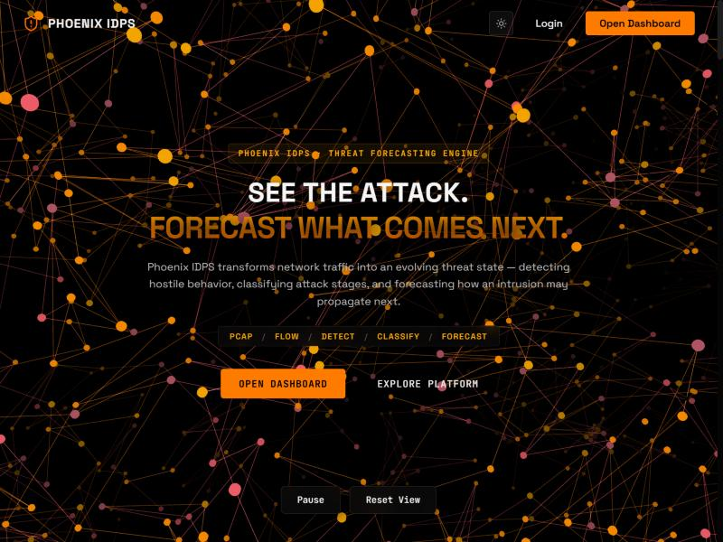
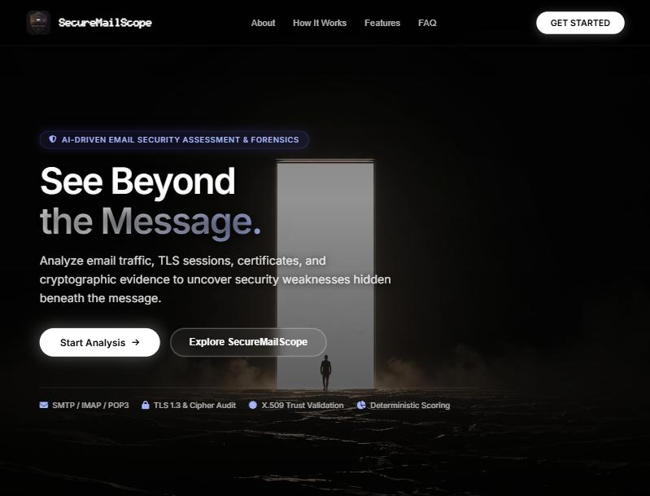

<h1 align="center">Hi, I'm Yash Bandiwadekar 👋</h1>

  

  
  

  

### About me

Final-year **Computer Science Engineering (Cybersecurity)** student at M.H. Saboo Siddik College of Engineering, Mumbai University (CGPA 8.84), aiming for **SOC / security operations** roles.

- 🛡️ **SOC Intern (L1)** at Shridhar InfoSec Solutions: triaging Wazuh alerts, handling cases in TheHive, enriching alerts with MISP, and tuning detections mapped to MITRE ATT&CK
- 🎯 **President, VAPT Excellence Centre**: I lead the college's cybersecurity cell, a team of 35+ students
- 🏆 **Best Research Paper Award** (Cybersecurity track), ICSSSD 2026
- ☁️ **AWS Certified Cloud Practitioner** · AWS re/Start Graduate · TryHackMe SEC1 & SEC0
- 📝 Short notes on security, DFIR and AD: [`til`](https://github.com/Yashbandiwadekar/til)

> 💼 **Open to:** SOC Analyst (L1) · Security Operations · DFIR roles, from mid-2027 · [Get in touch on LinkedIn](https://www.linkedin.com/in/yash-bandiwadekar)

### Featured projects

<table>
  <tr>
    <td width="50%" valign="top">
      
      <h4>🔥 Phoenix IDPS: network threat forecasting</h4>
      Turns network flows into a threat state, classifies the attack stage, maps it to <b>MITRE ATT&CK</b> and <b>forecasts intrusion progress 60 s ahead</b>, with evidence behind every alert. Trained on CIC-IDS-2018 (1.25M flow sequences). Includes a hash-chained audit ledger and CERT-In report drafting.
        
      <a href="https://phoenixidps.dpdns.org"><b>Live demo</b></a> · <a href="https://github.com/Yashbandiwadekar/network-attack-forecasting"><b>Code</b></a>
    </td>
    <td width="50%" valign="top">
      
      <h4>📧 SecureMailScope: email security forensics</h4>
      Parses PCAPs, rebuilds <b>SMTP/IMAP/POP3</b> sessions and audits TLS, ciphers and X.509 certificates. Flags plaintext credentials, missing STARTTLS and deprecated protocols, then gives a <b>0–100 risk score</b> and a JSON report.
        
      <a href="https://mailscope.dpdns.org"><b>Live demo</b></a>
    </td>
  </tr>
</table>

- **[MCP ↔ Splunk threat monitoring](https://github.com/Amin-Patel/mcp-splunk-server)**: an MCP server that lets an LLM run Splunk searches (SPL) and check alerts in plain English. Tested on Splunk BOTS v3.
- **[OWASP AI Model Watermarking](https://github.com/Yashbandiwadekar/owasp-ai-model-watermarking)**: zero-knowledge ownership verification for neural-network watermarks.

### Skills

**Security operations:** Splunk (SPL), Wazuh, ELK / OpenSearch, TheHive, MISP, log analysis, MITRE ATT&CK, VAPT, Burp Suite, Wireshark 
**Networking:** TCP/IP, DNS, HTTP/S, firewalls & ACLs, WAF rules, Nginx reverse proxy, rate limiting 
**Cloud & infra:** AWS (IAM, security groups, NACLs), Linux, Windows, Docker, Docker Compose 
**Scripting & AI:** Python, SQL, Bash, GitHub Actions, PyTorch, scikit-learn, LangChain, MCP

  

### GitHub stats

  
  

### Contribution snake 🐍

<picture>
  <source media="(prefers-color-scheme: dark)" srcset="https://raw.githubusercontent.com/Yashbandiwadekar/Yashbandiwadekar/output/github-snake-dark.svg" />
  
</picture>
